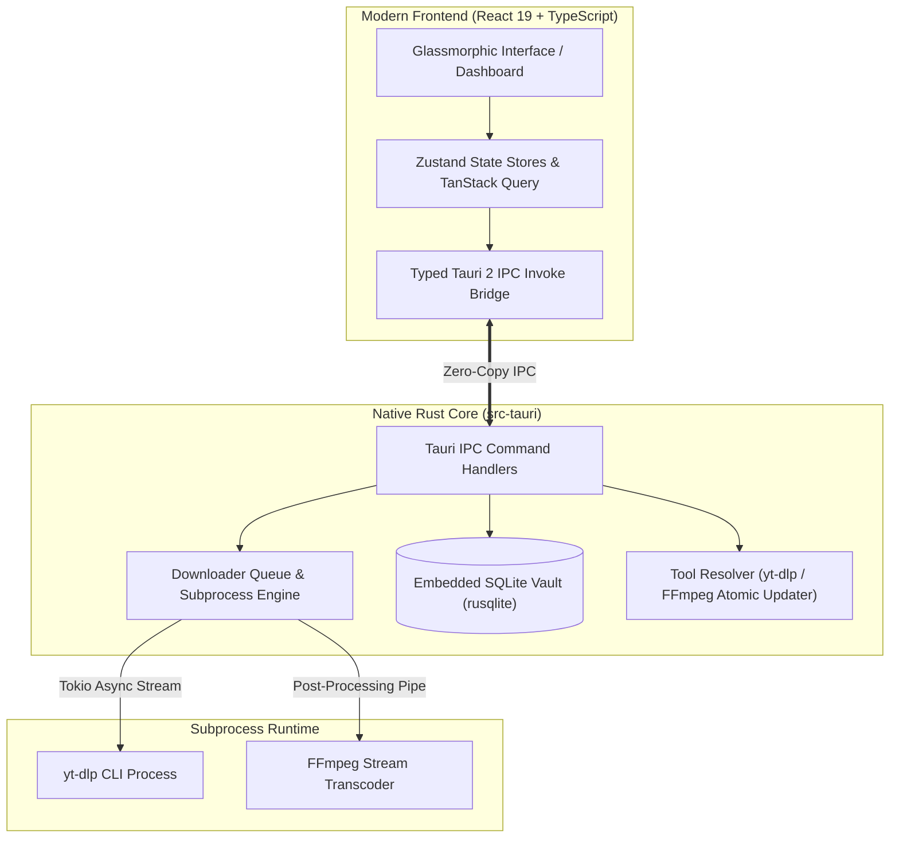

<p align="center">
  
</p>

<h1 align="center">Vortex — Next-Gen Desktop Media Downloader & Transcoder</h1>

<p align="center">
  <strong>An ultra-fast, modern, privacy-first desktop application built with Tauri 2, Rust, React 19, and SQLite. Powered by yt-dlp & FFmpeg.</strong>
</p>

<p align="center">
  <a href="https://github.com/sanjay-m6/Vortex-ytdlp/actions/workflows/ci.yml">
    
  </a>
  <a href="https://github.com/sanjay-m6/Vortex-ytdlp/actions/workflows/release.yml">
    
  </a>
  <a href="https://github.com/sanjay-m6/Vortex-ytdlp/releases/latest">
    
  </a>
  <a href="LICENSE">
    
  </a>
  
  
  
  
  
</p>

<p align="center">
  <a href="#-key-features">Features</a> •
  <a href="#-supported-platforms">Platforms</a> •
  <a href="#-architecture--tech-stack">Architecture</a> •
  <a href="#-github-actions-cicd-workflow">CI/CD Workflows</a> •
  <a href="#-quick-start--development">Quick Start</a> •
  <a href="#-contributing">Contributing</a> •
  <a href="#-support--donate">Donate</a>
</p>

---

## 💡 Why Vortex?

Traditional media downloaders are either bloated Electron apps consuming hundreds of megabytes of RAM, ad-ridden web utilities, or bare-bones terminal scripts that require memorizing CLI flags.

**Vortex** solves this by uniting the raw power of **yt-dlp** and **FFmpeg** with a lightweight native **Rust core** and a breathtaking **React 19 Liquid Glass interface**. It consumes a fraction of system memory, starts instantly, and gives you total control over video quality, audio bitrates, embedded metadata, and your private download history.

---

## ✨ Key Features

### 🚀 Blazing Native Core & Zero-Bloat Performance
- **Rust & Tokio Asynchronous Engine**: Non-blocking I/O stream orchestration with zero UI freezes during multi-gigabyte downloads.
- **Micro-Memory Footprint**: Built with **Tauri 2**; uses native OS webviews (Edge WebView2 / WebKitGTK) rather than packaging a whole Chromium instance.

### 🔍 Smart URL Analyzer & Batch Importer
- **Universal Extraction**: Supports YouTube, TikTok, Instagram Reels, X (Twitter), Vimeo, Reddit, SoundCloud, Twitch, and **1,000+** streaming platforms.
- **Rich Media Preview**: Instant metadata parsing — view titles, high-resolution thumbnails, channel badges, video duration, and view counts before starting.
- **Bulk & Batch Queue**: Import hundreds of URLs at once with single-click batch queuing and concurrency controls.

### 🎛️ Precision Transcoding & Lossless Audio
- **Video Resolutions**: 8K, 4K UHD (2160p), 2K QHD (1440p), 1080p Full HD, 720p, 60 FPS, HDR, and Best-Available streams.
- **High-Fidelity Audio Extraction**: One-click extraction to MP3 (up to 320 kbps), M4A (AAC), Lossless FLAC, WAV (PCM), and Opus.
- **Automatic Post-Processing**: Muxes separate audio/video streams losslessly via FFmpeg, injects original cover art thumbnails, and embeds multilingual subtitles (`.srt`/`.vtt`).

### 📊 Real-Time Telemetry & Progress
- **Live Diagnostics**: Real-time progress bars, dynamic transfer speeds (e.g. `14.2 MB/s`), accurate ETA countdowns, and byte counters.
- **Granular Step Tracking**: Transparent status indicators (`Fetching manifest`, `Downloading video stream`, `Merging via FFmpeg`, `Completed`).
- **Control**: Native pause, resume, cancel, and automated retry mechanisms.

### 🗄️ Embedded SQLite History Vault
- **Zero Cloud Leaks**: Your downloads and media history are stored locally in an embedded, fully encrypted-ready `vortex.db` SQLite database.
- **Fast Search & Reveal**: Filter by format, status, or date; open videos directly or jump straight to the downloaded file with one-click **"Show in Folder"** (native file explorer reveal).

### 🛠️ Self-Healing Binary Manager
- **Zero Setup Required**: Automatically resolves or downloads the latest official `yt-dlp` and `FFmpeg` binaries.
- **Atomic In-App Updates**: Built-in atomic `.tmp` swap updater ensures corrupted downloads never break your local tools.
- **Configurable Paths**: Easily toggle between bundled tools, system `PATH` executables, or custom enterprise tool locations.

---

## 🖥️ Supported Platforms

Vortex provides certified, automated cross-platform builds:

| Platform | Target Architecture | Distribution Packages | Minimum OS Version | Status |
| :--- | :--- | :--- | :--- | :--- |
| **Windows** | `x86_64-pc-windows-msvc` | `.exe` (NSIS Installer), `.msi` | Windows 10 (1809+) / Windows 11 | **Official Production** |
| **Linux** | `x86_64-unknown-linux-gnu` | `.deb` (Debian/Ubuntu), `.AppImage` | Ubuntu 20.04+, Debian 11+, Fedora 36+ | **Official Production** |
| **macOS** | `aarch64-apple-darwin` / `x86_64` | `.dmg`, `.app` | macOS 10.15 (Catalina) or newer | **Supported** |
| **Android** | `aarch64`, `armv7`, `x86_64` | `.apk`, `.aab` | Android 7.0+ (API Level 24+) | **Configured** |

---

## 🏗️ Architecture & Tech Stack



### Core Technologies
- **Application Framework**: [Tauri 2](https://v2.tauri.app/)
- **Backend & Systems**: [Rust](https://www.rust-lang.org/) (2021 Edition), Tokio, Rusqlite, Reqwest, RFD
- **Frontend Architecture**: [React 19](https://react.dev/), [TypeScript 6](https://www.typescriptlang.org/), [Vite 8](https://vitejs.dev/)
- **Styling & Motion**: [Tailwind CSS v4](https://tailwindcss.com/), Glassmorphism, Motion, Lucide Icons
- **State Management**: [Zustand](https://github.com/pmndrs/zustand), [TanStack Query v5](https://tanstack.com/query)
- **Engines**: [yt-dlp](https://github.com/yt-dlp/yt-dlp) & [FFmpeg](https://ffmpeg.org/)

---

## 🔄 GitHub Actions CI/CD Workflow

Vortex features a production-grade, enterprise CI/CD automation matrix under [`.github/workflows/`](file:///.github/workflows/):

```
.github/workflows/
├── ci.yml               # Automated static analysis, linting, formatting & Rust unit tests
├── build-desktop.yml    # Cross-platform matrix builder (Windows, Linux, macOS)
├── build-android.yml    # Dedicated Android APK & App Bundle compilation pipeline
└── release.yml          # Tag-driven release packager, checksum generator & publisher
```

### 1. `ci.yml` — Continuous Integration
- Triggered on all pull requests and pushes to `main`.
- Runs frontend static analysis: `npm ci`, `npx tsc --noEmit`, and `npm run build`.
- Configures Linux WebKitGTK / GTK3 / Ayatana AppIndicator build requirements on Ubuntu.
- Enforces strict formatting (`cargo fmt --check`) and zero compiler/clippy warnings (`cargo clippy -- -D warnings`).
- Executes the full 67-test Rust unit and integration test suite.

### 2. `build-desktop.yml` — Desktop Matrix Builder
- Compiles native production binaries across 3 parallel runner operating systems:
  - **Windows**: Produces clean `.exe` NSIS installer (user-level, non-elevated).
  - **Linux**: Produces Debian `.deb` packages and portable `.AppImage` containers.
  - **macOS**: Produces standalone universal `.dmg` disk images.
- Stores build outputs as downloadable GitHub Actions workflow artifacts.

### 3. `build-android.yml` — Android Mobile Pipeline
- Configures Java 17 Temurin, Android SDK 34, Android NDK 26b, and 4 Rust mobile targets (`aarch64`, `armv7`, `i686`, `x86_64`).
- Compiles optimized release APKs and Google Play-ready Android App Bundles (`.aab`).

### 4. `release.yml` — Automated Release Publisher
- Triggered when pushing an annotated version tag (e.g., `git push origin v1.0.0`) or manually via `workflow_dispatch`.
- Gates releases through full CI verification before building packages.
- Orchestrates parallel desktop and mobile builds.
- Computes cryptographic SHA-256 hashes (`SHA256SUMS.txt`) for binary integrity verification.
- Publishes a formatted GitHub Release with platform packages and release notes automatically attached.

> For detailed local build instructions and signing setup, see the complete [Build & Release Guide](docs/BUILD_AND_RELEASE.md).

---

## 🚀 Quick Start & Development

### Prerequisites
- **Node.js**: `20.x` LTS or later
- **Rust**: `1.80+` (`rustup default stable`)
- **C++ Tools**:
  - **Windows**: Visual Studio 2022 C++ Build Tools & Windows SDK
  - **Linux**: `libwebkit2gtk-4.1-dev`, `libgtk-3-dev`, `libayatana-appindicator3-dev`, `librsvg2-dev`
  - **macOS**: Xcode Command Line Tools

### 1. Clone & Install Dependencies
```bash
git clone https://github.com/sanjay-m6/Vortex-ytdlp.git
cd Vortex-ytdlp
npm install
```

### 2. Run in Desktop Development Mode
```bash
npm run tauri dev
```
*This launches the Vite development server with HMR alongside the native Vortex desktop window.*

### 3. Run Quality Checks & Tests
```bash
# Validate TypeScript
npx tsc --noEmit

# Lint & check Rust code
cargo fmt --manifest-path src-tauri/Cargo.toml -- --check
cargo clippy --manifest-path src-tauri/Cargo.toml -- -D warnings

# Run all 67 backend unit & integration tests
cargo test --manifest-path src-tauri/Cargo.toml
```

### 4. Compile Production Installers
```bash
# Build for your host operating system
npm run tauri build
```
Compiled installers will be placed in `src-tauri/target/release/bundle/`.

---

## 🤝 Contributing

Contributions are what make the open-source community such an amazing place to learn, inspire, and create. Any contributions you make are **greatly appreciated**!

### Development Workflow
1. **Fork the Project** (`https://github.com/sanjay-m6/Vortex-ytdlp/fork`).
2. **Create your Feature Branch**:
   ```bash
   git checkout -b feat/amazing-feature
   ```
3. **Commit your Changes**:
   ```bash
   git commit -m 'feat: add support for custom audio bitrates'
   ```
4. **Run Local Checks** (Ensure tests pass and there are zero warnings):
   ```bash
   npm run build
   cargo test --manifest-path src-tauri/Cargo.toml
   cargo clippy --manifest-path src-tauri/Cargo.toml -- -D warnings
   ```
5. **Push to the Branch**:
   ```bash
   git push origin feat/amazing-feature
   ```
6. **Open a Pull Request** against the `main` branch.

### Engineering Standards
- **Zero-Warning Policy**: All PRs must compile with `cargo clippy -- -D warnings` and `cargo fmt --check`.
- **UI Consistency**: Maintain the established Liquid Glass dark/light theme tokens and spacing grid.
- **Security First**: Ensure all user inputs are sanitized; never introduce path-traversal vulnerabilities or expose unredacted authentication tokens in logs.

---

## 💖 Support & Donate

If you enjoy using **Vortex** or find it helpful in your daily workflow, consider supporting its active development. Your support helps keep Vortex completely ad-free, fast, and maintained with upstream streaming protocol changes!

<p align="center">
  <a href="https://ko-fi.com/infinity86" target="_blank">
    
  </a>
  &nbsp;&nbsp;
  <a href="https://paypal.me/infinity86s?locale.x=en_GB&country.x=IN" target="_blank">
    
  </a>
  &nbsp;&nbsp;
  <a href="https://github.com/sponsors/sanjay-m6" target="_blank">
    
  </a>
</p>

⭐ **Free way to support:** Don't forget to **Star the repository** on GitHub! It helps more users discover the project.

---

## ⚖️ License & Legal Disclaimer

- **License**: Distributed under the **Apache License 2.0**. See [`LICENSE`](LICENSE) for more information.
- **Disclaimer**: **Vortex** is intended solely for personal backup, archival, and fair-use media downloading of non-copyright-infringing content. The developers do not host media and are not responsible for user misuse. Always adhere to your local copyright laws and platform terms of service.

---

<p align="center">
  Crafted with care by the <strong>Vortex Team</strong> • Built with Tauri & Rust
</p>
